# ATDS — Portail de visualisation

Ce dossier est le **point d'entrée GitHub** vers les interfaces de cartographie et de présentation du projet **Adaptive Trading Decision System (ATDS)**.

> **État : portail documentaire et liens locaux.** Aucune nouvelle application n'est hébergée par GitHub. La création de ce dossier ne modifie ni les données d'ATDS, ni sa branche gouvernée `integration/system-v1`, ni la branche `main`. Ce dossier est conservé dans une branche de présentation indépendante.

## Accès aux différentes interfaces

| Interface | Ouvrir depuis le PC hébergeant SAE | Contenu |
| --- | --- | --- |
| **React Flow — SAE ATDS Visual 01 (UX-CR2)** | [Ouvrir React Flow V2 — port 8816](http://127.0.0.1:8816/?utm_source=chatgpt.com) | Architecture, arborescence, relations, sources & preuves ; **7 dispositions** indépendantes |
| **ATDS Atlas V3.0** | [Ouvrir l'Atlas immersif — port 8817](http://127.0.0.1:8817/) | **13 sous-systèmes documentaires**, **8 scènes guidées**, mode plein écran, preuves et accès au navigateur technique |

### Important : liens locaux

`127.0.0.1` désigne **l'ordinateur de la personne qui ouvre le lien**. Ces deux adresses fonctionnent uniquement si l'application et les serveurs correspondants tournent sur **ce même ordinateur**. Un visiteur distant ne peut pas visualiser le système simplement en cliquant sur ces liens depuis GitHub.

Pour les lancer sur le PC où les applications ont été qualifiées, les fichiers se trouvent dans **Téléchargements** :

- `OUVRIR-ATDS-VISUAL-01.bat` — interface React Flow V2, port **8816**.
- `OUVRIR-ATDS-ATLAS.bat` — Atlas V3, port **8817**.

Le lien vers l'interface React Flow peut aussi être saisi directement dans Edge sous la forme `http://127.0.0.1:8816/` (le paramètre `utm_source` n'est pas nécessaire).

## Carte conceptuelle consultable directement sur GitHub

Cette carte se consulte dans le présent README sans installation. **Les flèches pointillées correspondent à 16 relations d'explication documentaire**, **pas** à des dépendances d'exécution, des appels API prouvés ni des permissions de trading.

```mermaid
flowchart LR
  subgraph F1["01 — Observer et qualifier"]
    data["Données et provenance"]
    admit["Admissibilité"]
    asset["Profil d'actif"]
  end
  subgraph F2["02 — Comprendre et explorer"]
    context["Contexte et régimes"]
    research["Recherche et expériences"]
    router["Experts et sélection"]
  end
  subgraph F3["03 — Décider et encadrer"]
    decision["Décision et autorisation"]
    risk["Risque et capital"]
    execution["Exécution et coûts"]
  end
  subgraph F4["04 — Évaluer et gouverner"]
    outcomes["Résultats et traces"]
    evaluate["Évaluation et promotion"]
    memory["Mémoire et révision"]
    governance["Gouvernance"]
  end

  data -.-> admit
  admit -.-> asset
  asset -.-> context
  context -.-> research
  research -.-> router
  router -.-> decision
  decision -.-> risk
  risk -.-> execution
  execution -.-> outcomes
  outcomes -.-> evaluate
  evaluate -.-> memory
  memory -.-> governance
  governance -.-> decision
  context -.-> router
  evaluate -.-> research
  data -.-> research
```

### Ce qui est documenté et ce qui ne l'est pas

- La projection technique qualifiée inventorie **2 690 fichiers** et **8 574 relations statiques** au HEAD épinglé `91fc53c406c67acde340599cb0ba35fd5347b02d`.
- La carte documentaire historique V2.0 contient **13 sous-systèmes**, **16 liaisons explicatives** et **26 sources de preuve** au même commit.
- L'inventaire des fichiers n'atteste pas que toutes les fonctionnalités s'exécutent réellement. L'ancien modèle documentaire est partiel et ne prouve pas une architecture runtime complète.
- L'accès de tiers à une véritable interface web nécessitera un déploiement séparé (par exemple, une version statique revue pour GitHub Pages), avec une **décision explicite** sur les données à exposer.

## Traçabilité et séparation

- Dépôt source : [ADAPTIVE-TRADING-DECISION-SYSTEM](https://github.com/thboulevart-creator/ADAPTIVE-TRADING-DECISION-SYSTEM).
- Référence technique visualisée : [commit épinglé](https://github.com/thboulevart-creator/ADAPTIVE-TRADING-DECISION-SYSTEM/tree/91fc53c406c67acde340599cb0ba35fd5347b02d).
- Référentiel de visualisation local : **SAE-ATDS-VISUAL-01 UX-CR2** et **SAE-ATDS-ATLAS V3.0**.
- Aucun watcher, déploiement, modification du code ATDS, activation de trading ou synchronisation automatique n'est déclenché par ce README.
